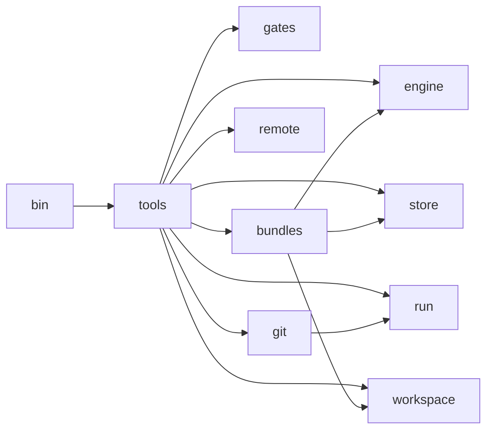
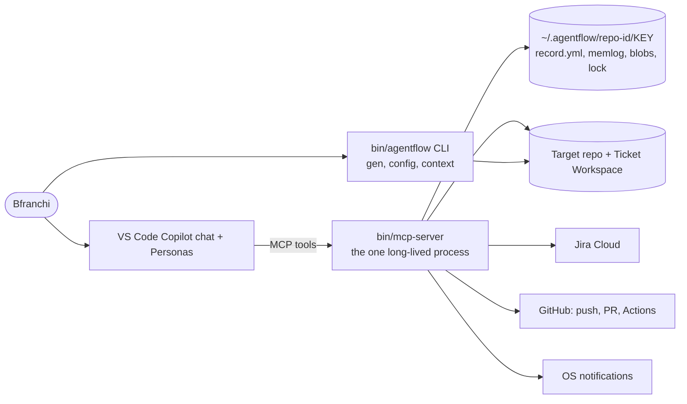
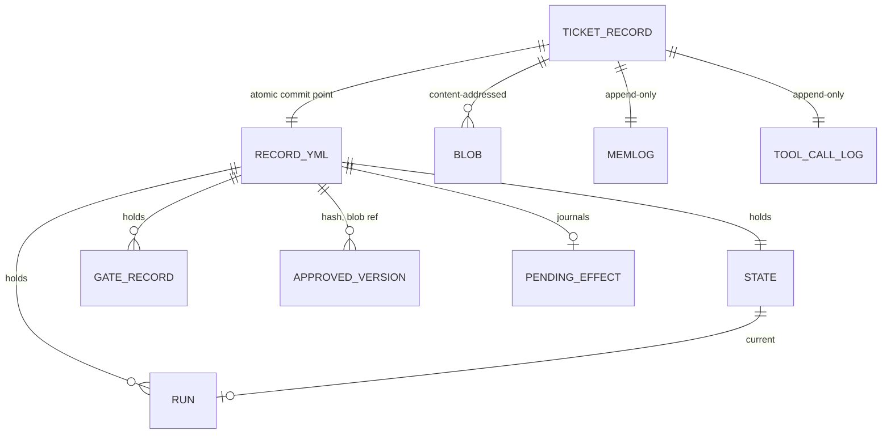

# Architecture Spine — Agentflow MVP

Terms (Ticket, Run, Gate, Server Record, …) are the PRD §3 Glossary terms, used verbatim. Revision 2: simplified to one long-lived process; AD ids are stable, retired ids are listed under *Retired*.

**Threat model.** The adversary is agent drift and accident, not malicious same-user code. Personas are untrusted workers that may take wrong or out-of-policy actions; code running as the same OS user (including repo test code) is not defended against beyond the env scrubbing in AD-9. The protection is structural: state lives outside the workspace (Copilot's edit tools reach only the workspace), every tool call is checked against its Run and Persona, approved artifacts are pinned by hash, and every change is attributed by Snapshot. Accepted residue: a same-user process can write `~/.agentflow/`; no cryptographic tamper-proofing is attempted. The Conductor's identity cannot be proven over stdio MCP.

## Design Paradigm

**Pure engine, effects at the edge.** `engine` is a table-driven interpreter of the Stage Graph: `decide(state, event) → {state′, effects[]}`, with no I/O. Everything else is plain folders that perform effects or adapt the host. One process runs it: the MCP server started by VS Code. The CLI is only for configuration and generation.

| Folder (`src/`) | Holds |
| --- | --- |
| `engine/` | Stage Graph table, `decide`, counters, Waves scheduler, trace, triage classification, schemas (Zod) |
| `store/` | `~/.agentflow/<repo-id>/` record read/write, the repo lock |
| `workspace/` | reading and writing the Ticket Workspace and `.agentflow/` config files (the only code that does) |
| `tools/` | MCP tool handlers: thin, validate, call `engine`, run effects |
| `gates/` | elicitation channel, always-confirm fallback |
| `git/` | temp-index Snapshots, commit, fast-forward push |
| `run/` | no-shell command runner, timeout and tree kill, env scrubbing, Vitest/Jest parser |
| `remote/` | `jira.ts`, `github.ts` (PR, CI poll timer) |
| `bundles/` | Input Bundles, Review Bundles, token budgets |
| `bin/` | `mcp-server.ts` (the only long-lived process), `agentflow.ts` (CLI: `gen agents`, `config models`, `context`) |

## Invariants & Rules



`engine` imports no other `src/` folder and no `fs`, `child_process`, `net`, `Date` or `Math.random`. Allowed edges are exactly those drawn; `bin/` imports `tools/` (and `workspace/` for the CLI). A unit test asserts that `engine` has no forbidden imports. Only `git`, `remote`, `run`, `store`, `workspace` and the clock/id source get test fakes.

### AD-1 — The engine is pure; tools are thin

- **Binds:** all FRs, NFR-1, NFR-4
- **Prevents:** pipeline logic scattered across tool handlers, so two tools disagree about what happens next
- **Rule:** Any decision that affects State, Gates, counters, Waves, Trace, triage or Bundle contents is an `engine` function. A tool handler validates input, calls `engine`, runs the returned effects, and formats output; it does not branch on Stage, Goal Phase or Gate kind. `decide` takes `now` and any new ids as arguments, so the same State, event, graph and arguments always give the same output; wall-clock time is used only for timestamps and timeouts, never for branching.

### AD-2 — The Stage Graph is the only source of transitions

- **Binds:** FR-4, FR-5, FR-46, NFR-4
- **Prevents:** transitions hard-coded in handlers; the YAML graph and behaviour diverging
- **Rule:** `stage-graph.yml` is loaded and validated once (FR-4 checks). `decide` is the only function that produces a new State, and every transition it makes resolves to exactly one graph row, whose id is stored in the Memlog entry. Every Stage declares its owner: `persona` (a Run is launched), `gate` (a human decides) or `tool` (the server runs it inside `state_advance` chaining). Handlers return events; they never write State.

### AD-19 — One record per Ticket, committed by one atomic rename, under one repo lock

- **Binds:** FR-2, FR-5, FR-6, FR-34, FR-48, FR-50, NFR-5
- **Prevents:** a crash between two file writes leaving State and Gate Records inconsistent; two MCP servers (two VS Code windows) or two active Tickets mutating one repo; agents reaching the record through workspace tools
- **Rule:** The Server Record lives at `~/.agentflow/<repo-id>/<KEY>/` (`os.homedir()`), never inside the workspace. `record.yml` holds everything authoritative for the Ticket (State, Gate Records, Approved Version hashes, counters, Run Reports, Snapshot ids, pending effect); it is replaced atomically (temp file + rename, bounded retry on `EPERM`/`EBUSY`), so it is the single commit point. Content-addressed blobs (Approved Version copies, stashes' metadata) are written before the rename that references them. `memlog.md` is an append-only log whose line count is recorded in `record.yml`; a Memlog longer than recorded is truncated back on resume. `tool-calls.yml` is append-only, never truncated, and unrecorded. Run Metrics are written to `metrics.yml` in the Ticket's record directory at a terminal Stage. Every record mutation (State, Gate, Run, CI result) goes through one per-Ticket async mutex held for the read-modify-write-rename; the CI timer and parallel Reviewer calls only post events through it and never write State themselves. If a commit fails, the in-memory copy is dropped and the record is re-read from disk. On every start the server generates a `boot_id`, stored in the record; a Run issued under another `boot_id` is treated as discarded (FR-6) and its later tool calls are refused with `E_STALE_RUN`. At startup `mcp-server` retries the lock for up to 10 s (a reload releases it), then takes `~/.agentflow/<repo-id>/lock` (exclusive create) holding its pid, and touches the file every 30 s; the lock is stale when its mtime is older than 90 s, regardless of pid (Windows reuses pids), and a stale lock is replaced. A fresh lock makes `mcp-server` exit with an error naming the holder; after a crash, starting again within 90 s fails with that message and succeeds afterwards (or `agentflow unlock` removes a stale lock). Only the lock holder writes the record. `repoId()` is one function: SHA-256 (first 16 hex) of the realpath of `git rev-parse --git-common-dir`, lowercased on win32, `/`-separated. Ids (`R-n`, `GR-n`, `H-n`) are counters inside `record.yml`. Windows-first: home and state paths come from `os.homedir()` and `path`; paths stored in records and documents are repo-relative with `/` separators; `repoId()` normalizes case and real paths so aliases (junctions, `subst`, drive-letter case) give one record location; no tool or script depends on `sh`/`bash`.

### AD-20 — Effects are repeatable; the ordered effect journal is committed first

- **Binds:** FR-17, FR-26, FR-30, FR-41, NFR-5, NFR-9
- **Prevents:** a crash between "git push succeeded" and "State says pushed" causing a wrong resume, a duplicate PR, Jira comment or commit, or a half-applied tree restore
- **Rule:** `decide` returns `effects[]`. The new State and the whole list are committed together as `pending: [{kind, key}, …]` in `record.yml` before the first effect runs; each effect is then run in order and marked done (one commit per effect). On startup and on every `state_get` a non-empty `pending` is resumed first. Each effect is repeatable: pushing an already-pushed SHA is a no-op; `pr_upsert` creates or updates; a Jira transition first reads the current status and skips if already there; a Jira comment carries a marker (`[agentflow:<KEY>:<effect-key>]`) and is skipped if a comment with it exists; `commit:<run-id>` first looks for an existing commit with that trailer. Local tree mutations (restoring a start Snapshot, saving a discarded Run) are effects too, so they are journaled. A discarded Run's work is kept under `refs/agentflow/<KEY>/<run-id>`, not `git stash`.

### AD-21 — CI watch and notifications run inside the MCP server

- **Binds:** FR-1, FR-3, FR-27, FR-30, FR-49
- **Prevents:** a background process for a task that only matters while VS Code is open
- **Rule:** There is no daemon. `start-ticket` with no key runs the one JQL query (FR-1 default) over Tickets with no Intent Record and lists them; `start-ticket <KEY>` skips the list. After a push the record stores an absolute CI deadline (push time + `ci.max_wait`, wall clock, so laptop sleep cannot extend it) and the server arms a timer (`ci.poll_interval`) that polls GitHub Actions for the pushed SHA. The timer only posts a `ci_result` event through the record mutex (AD-19); `decide` does the transition, then a desktop notification is sent. Startup recovery re-runs `pending` (AD-20) and re-arms the timer for any Ticket in `ci_running`; if VS Code was closed, the next `start-ticket` also checks CI once and resumes. Every call to Jira or GitHub is outbound only; a failure returns a typed error and leaves State unchanged (VPN drops are retried on the next action). The server notifies when it adds a Wait Reason; notifications are best-effort and every wait is also reported by `start-ticket`. The Ticket snapshot is taken when the Ticket is started, not by polling.

### AD-6 — Every tool call is checked against its Run and Persona

- **Binds:** FR-5, FR-8, FR-16, FR-40, FR-41, FR-44
- **Prevents:** an agent calling a tool its Persona was not given (OQ-8), reporting for another Run, a retried call minting two Runs, and Personas with no way to return structured output
- **Rule:** Every agent-callable tool takes `run_id` first; the wrapper resolves it against the Ticket's active Runs (`runs` map in State; one entry except for the parallel Reviewers of `validate`, FR-22, where `state_get` may return `run_personas[]`) and the Persona's tool list from `personas.yml` (AD-12) before the handler runs, else `E_NOT_AUTHORIZED`. Conductor-only tools (`state_get(key)`, `state_advance`, `gate_request`, `gate_confirm`) are refused when called with a `run_id`. `state_get` is idempotent: it returns the outstanding directive instead of creating another Run, and `run_report`/`state_advance` replay their stored result when repeated. Every Persona may call `bundle_get(run_id)` and ends with `run_report(run_id, status, summary, reason?, result?)`, where `result` is validated by a per-Persona schema (verdicts, Walkthrough judgment parts, curator proposals, Handoff result) and the server, not the agent, writes the corresponding document.

### AD-7 — Gate decisions come only from a human channel response

- **Binds:** FR-8, FR-9, FR-42, FR-46
- **Prevents:** an agent-supplied value becoming a Gate decision
- **Rule:** `gates/` is the only code that builds a Gate Record, and only from a channel response (`elicitation`, then `tool_confirmation`); no tool accepts a decision argument. A Gate Record stores the `subject_digest` of the artifact version decided (used for freeze matching) and the `shown_digest` of the exact bytes shown (audit only). `gate_request` is idempotent: it returns the existing pending Gate for the same subject. The CLI one-time-code channel (FR-42 fallback 2) is built only if the week-1 proof shows both other channels fail. Irreversible lifecycle commands (`stop`, `skip`, `start-ticket --restart`) are Conductor-only tools that each open a `confirm_action` Gate through the same human channel before acting; no Persona has them. `skip` on a never-started Ticket writes a minimal `skipped` record so the poller never lists it again.

### AD-8 — Approved artifacts are pinned by hash; agent documents enter through validators

- **Binds:** FR-10, FR-11, FR-12, FR-13, FR-28, FR-29, FR-40, FR-51
- **Prevents:** a hand-edited Spec or Plan treated as approved; an agent editing pipeline configuration; two readers seeing different Current Plans
- **Rule:** The server writes `requirements.md`, `plan.md`, `patch-<n>.md`, `correct-course-<n>.md`, `handoffs/H-n.yml`, `walkthrough.md`, `verdict.yml`, `trace.yml`, `ci_failure.yml` and `ticket.json` itself (agents supply content only through validating tools: `doc_scaffold`, `handoff_create`, `run_report.result`). On approval it stores the artifact's bytes and SHA-256 as the Approved Version; before every transition it re-hashes the file on disk and compares (FR-10). At `start-ticket` it also records a digest of `config.yml`, `stage-graph.yml`, `personas.yml`, `tools/*.yml`, `prompts/` and `templates/`; a mismatch raises Ask Human `config_changed`, and `commit_prepare` and the push Gate refuse any path under `.agentflow/`. `.agentflow/` is excluded from Snapshots, attribution and the FR-43 clean-tree check (its integrity is this digest plus the server-written documents); `preferences.md`, `pitfalls.md` and `config models` changes are written by the server or CLI outside any Run and are never part of a pipeline commit. Every reader gets the Current Plan from one function, `currentPlan(key)` (plan + approved Patch Plans in order). Hashes are over the exact bytes the server wrote.

### AD-9 — Child processes run through one runner with per-purpose environment profiles

- **Binds:** FR-18, FR-19, FR-20, FR-21, NFR-6, NFR-9
- **Prevents:** repo test code reading `JIRA_API_TOKEN`/`GITHUB_TOKEN`; git losing the user's identity and credential helper; shell injection; a child inheriting the MCP server's stdio and corrupting the protocol; a timed-out grandchild holding files; `.cmd` shims failing without a shell
- **Rule:** All commands go through `run.exec(argv, {cwd, timeoutMs, envProfile})` with `argv` an array and no shell; stdio is `['ignore','pipe','pipe']`. Two environment profiles exist. `repo-code` (tests, lint, type-check, anything running repo code) is a per-platform allowlist (win32: `PATH`, `PATHEXT`, `SystemRoot`, `ComSpec`, `TEMP`, `TMP`, scratch `USERPROFILE`, `APPDATA`, `LOCALAPPDATA`; POSIX: `PATH`, scratch `HOME`, `TMPDIR`) plus repo-configured vars; secrets and the user's git identity are not on it (repo tests that run git configure their own). `git` (used only by `git/`) is the process's real environment minus `JIRA_*`, `GITHUB_TOKEN` and any config-listed secret names, so the user's global `.gitconfig` (identity) and Git Credential Manager keep working; pushes use those credentials, and `GITHUB_TOKEN` is used only by `remote/github` for API calls. Package-manager shims are resolved to their Node entry points. On timeout the whole process tree is killed (`taskkill /T /F` on Windows) and confirmed gone before the next Snapshot. Output goes through a per-runner parser (Vitest/Jest JSON) into Failure Payloads; raw output never reaches a model.

### AD-10 — Git access through one module; Snapshots use a temporary index

- **Binds:** FR-17, FR-26, FR-41, FR-43, NFR-6
- **Prevents:** Snapshots that stage files in the real index; commits containing unattributed files; force-pushes; git calls scattered across tools; hashes depending on user git config
- **Rule:** Only `git/` touches git, always with the `git` env profile (AD-9). A Snapshot is `git write-tree` over a temporary index (`GIT_INDEX_FILE`) built with `add -A` plus an explicit pathspec exclude for `.agentflow/tickets/`, with `core.autocrlf` and `core.safecrlf` pinned, and `commit_prepare` uses the same pinned values so Snapshot and commit trees are comparable; `run_report` with status `0` verifies the tree equals the commit HEAD under that config, so post-commit edits are caught; the real index and working tree are never modified by a Snapshot. `commit_prepare` stages exactly the Run diff (start → end Snapshot) and commits; it refuses protected branches and `.agentflow/` paths. Push is fast-forward only of an exact SHA to `origin/agentflow/<KEY>`; the module has no force option. `index.lock` contention is retried with bounded backoff.

### AD-11 — One bundle builder, budgets measured the same way everywhere

- **Binds:** FR-22, FR-36, FR-37, FR-47, NFR-1, NFR-8, NFR-10
- **Prevents:** Input Bundles assembled differently per Persona, silent budget overruns, untrusted text read as instructions
- **Rule:** Input and Review Bundles are built only by `bundles/` from a declarative per-(Persona, Goal Phase) recipe. Token estimate is `utf8Bytes / 4` everywhere (generator, runtime, tests). Truncation order is fixed: Memlog oldest-first, then Preferences/Pitfalls oldest-first, then Project Context tail, with a Memlog warning. Untrusted text (Jira content, test output, diffs) is placed in delimited blocks that Persona prompts name as data, never instructions. A secret-pattern redaction pass in `present()` covers everything sent to a model.

### AD-12 — `personas.yml` is the single source for Personas, Tiers and tool allowlists

- **Binds:** FR-8, FR-38, FR-39, FR-40, FR-42, NFR-10, OQ-1, OQ-3, OQ-8, OQ-9, OQ-10, OQ-12
- **Prevents:** generated `.agent.md` files granting a tool the runtime check (AD-6) denies, or the reverse; an unanswered Copilot capability question leaking into `engine`
- **Rule:** `agentflow gen agents` and the runtime check read `personas.yml` through one `loadPersonas()`. The generator is deterministic (stable ordering, no timestamps), fails on over-budget prompts, and maps logical tool names to host tool names through one table. Tier→model resolution (project, then local layer) is one function. Host-dependent behaviour (Copilot capability open questions) stays isolated: elicitation and confirmation live only in `gates/`, host tool names and agent-file format only in the generator's mapping table, and the per-Run model is the `model` field of `run_persona`; week-1 proof findings change those places or config, never graph rows or schemas.

### AD-13 — One schema source; one signature function; unambiguous Scenario matching

- **Binds:** FR-8, FR-10, FR-18, FR-20, FR-21, FR-45, NFR-7
- **Prevents:** schema drift; a Loop Checkpoint that never fires because failure signatures differ per line number; `S1.1.1` matching `S1.1.10`
- **Rule:** Each document kind has one Zod schema in `engine/schemas`; `.agentflow/schemas/` is generated from them. YAML for config, schemas and records; JSON only for `ticket.json` and raw runner output (NFR-7). The Failure Signature is `sha256(id \n file-path \n normalized first message line)` and excludes line and column numbers so a moved failure still counts as a repeat (a deliberate narrowing of the PRD's `location`; see deltas). A test title matches a Scenario only if it begins with the Scenario id followed by whitespace (`^S\d+\.\d+\.\d+\s`).

### AD-14 — Tool contract: typed envelope, enumerated errors, trimming at the boundary

- **Binds:** FR-5, FR-20, FR-44, FR-50, NFR-4, NFR-9
- **Prevents:** free-text tool results; silent failures; untrimmed output reaching a model
- **Rule:** Every tool returns `{ok: true, data}` or `{ok: false, error: {code, message, details?}}` with `code` from one enumerated `ErrorCode` set in `engine`. `state_get(key)` returns exactly one of `run_persona | open_gate | wait | end`. Output for a model passes `present()` (`failures.max`, line caps, redaction). Every call, including refused ones, appends a Tool-Call Log entry. If the OQ-13 proof shows tool calls time out, a `{ok: true, pending: {job_id}}` variant and `job_get` are added then.

### Retired

| Retired | Why | Replaced by |
| --- | --- | --- |
| AD-3 (signed manifest chain, lease locks) | Single writer process; state is outside the workspace | AD-19 |
| AD-4 (leased idempotent intents) | One process; effects repeatable | AD-20 |
| AD-5 (daemon, observations, heartbeat) | Daemon removed | AD-21 |
| AD-17 (parallel mode additive) | Parallel Waves (§4.11) are post-MVP; revisit when built | — (see Deferred) |
| AD-15 (injected time and ids) | Merged, nothing lost | AD-1 |
| AD-16 (host-dependent behaviour isolated) | Merged, nothing lost | AD-12 |
| AD-18 (Windows-first paths) | Merged, nothing lost | AD-19 |

## PRD alignment

The PRD and addendum (revisions of 2026-11-13, saved 11:17) carry every decision in this spine, including the Repo Lock heartbeat, `refs/agentflow/` for discarded work, `run_report` replay, `bundle_get`, `confirm_action`, `metrics.yml` and the git environment profile. There are no known deltas; if the two ever disagree again, fix the PRD or amend an AD, and record it in the memlog.

## Consistency Conventions

| Concern | Convention |
| --- | --- |
| Naming | Files `kebab-case.ts`; types `PascalCase`; Stage and Goal Phase ids exactly as FR-4 (`implement:green`); tool names `snake_case` as in the addendum; Persona ids lowercase as in the glossary |
| Ids | `R-n`, `GR-n`, `H-n`, `G<n>`, `AC-n`, `S<goal>.<item>.<n>`; monotonic per Ticket, never reused, allocated inside `record.yml` (AD-19) |
| CLI | `agentflow unlock` removes a stale repo lock (AD-19) |
| Time | ISO 8601 UTC with `Z`; code durations in ms; config keys suffixed `_seconds` or `_minutes` |
| Hashes | SHA-256 lowercase hex over the exact bytes written (AD-8); Failure Signature per AD-13 or the literal `missing_report` |
| Errors | `ErrorCode` enumeration in `engine`; typed errors mapped to the envelope once (AD-14); no `catch` that swallows |
| Config | `config.yml` < `config.local.yml`; secrets only from env vars; one `loadConfig()` with a Zod schema, unknown keys rejected |
| Logging | Memlog and Tool-Call Log are the logs; process diagnostics to `~/.agentflow/logs/mcp-server.log`; never to stdout of the stdio server |
| Statuses | Wait Reasons, Status Codes, Gate decisions, `ask_human` reasons (plus `config_changed`) are string-literal unions defined once in `engine/schemas` |
| Tests | Vitest; `engine` tested without fakes; fakes only for `git`, `remote`, `run`, `store` and the clock/id source; each graph row has a test named by its row id |

## Stack

| Name | Version |
| --- | --- |
| Node.js | 26 LTS (26.13.1); `engines` floor `>=24.15.0` (node-notifier 12 requirement) |
| TypeScript | 7.0.2 |
| @modelcontextprotocol/sdk | 1.32.2 (targets MCP spec 2025-11-25) |
| zod | 4.6.7 |
| yaml | 2.9.1 |
| vitest | 5.1.0 |
| @octokit/rest | 22.0.1 |
| commander | 15.1.0 |
| execa | 10.2.1 |
| node-notifier | 12.1.0 (`duration: 'long'` on Windows) |
| git (runtime) | ≥ 2.40 (2.53.0 on dev machine) |

## Structural Seed





Deployment and environments (operational envelope): everything runs on the developer's machine; there is no hosted environment and no service to operate. `bin/mcp-server` is started by VS Code from `.vscode/mcp.json`; it holds the repo lock for its life, runs the CI timer, and ends with the chat. `agentflow` is on PATH for `gen agents`, `config models`, `context` and `init` `[ASSUMPTION: init scaffolds .agentflow/, .github/ files and git-ignore entries]`. Install is a local build of this repo (`npm link` or global install). The pipeline's own CI (GitHub Actions) runs type-check and Vitest. Observability is the Memlog, Tool-Call Log, Run Metrics and the log file. Backup of `~/.agentflow/` is the user's; a record that fails to parse raises Ask Human and the user restores or stops the Ticket.

```text
agentflow/                      # this repository, one package
  src/{engine,store,tools,gates,git,run,remote,bundles}/
  bin/{mcp-server.ts,agentflow.ts}
  templates/ prompts/ schemas/  # shipped defaults copied by `agentflow init`
target-repo/
  .agentflow/                   # config, stage-graph, personas, prompts, tools, templates, schemas(generated), preferences, pitfalls, tickets/<KEY>/ (git-ignored)
  .github/                      # copilot-instructions.md, agents/ (generated), skills/start-ticket/
~/.agentflow/<repo-id>/         # lock, <KEY>/{record.yml, memlog.md, tool-calls.yml, blobs/}, logs/
```

## Capability → Architecture Map

| Capability / Area | Lives in | Governed by |
| --- | --- | --- |
| Ticket Intake, notifications (FR-1–3, FR-49 as amended) | `tools/start-ticket`, `remote/jira`, `remote/github` | AD-21, AD-19 |
| Stage Graph, State Tool, chaining, counters, resume (FR-4–7, FR-43) | `engine/`, `tools/state` | AD-1, AD-2, AD-6, AD-19, AD-20 |
| Server Record integrity (FR-48, FR-50) | `store/` | AD-19, AD-8 |
| Gates and freeze (FR-8–10, FR-42, FR-46, FR-51) | `gates/`, `engine/` | AD-7, AD-8, AD-12 |
| Personas, tool sets, Tiers (FR-38–40) | `personas.yml`, `bin/agentflow gen`, `tools/` wrapper | AD-6, AD-8, AD-12 |
| Attribution, commits, push (FR-17, FR-26, FR-41) | `git/` | AD-9, AD-10, AD-20 |
| Spec and Plan documents (FR-11–14, FR-28–29) | `engine/docs`, `engine/schedule`, `tools/doc` | AD-8, AD-13 |
| TDD Runs, Checks, triage, Trace (FR-15–16, FR-18–21, FR-44, FR-47) | `engine/`, `run/` | AD-6, AD-9, AD-11, AD-13, AD-14 |
| Validation (FR-22–23) | `bundles/`, `engine/verdict` | AD-6, AD-11 |
| Escalation, Ask Human (FR-24–25, FR-45) | `engine/`, `gates/` | AD-2, AD-7 |
| CI watch, Done (FR-27, FR-30 as amended) | `remote/github`, `remote/jira` | AD-20, AD-21 |
| Memory and learning (FR-34–37) | `engine/memlog`, `bundles/` | AD-11, AD-19 |
| Token budgets (NFR-10) | `bundles/`, `bin/agentflow gen` | AD-11, AD-12 |

## Deferred

| Decision | Why it can wait / revisit condition |
| --- | --- |
| Parallel Goal execution (§4.11, FR-31–33) | Post-MVP; when built, revisit single `Run` in State (becomes a map), Claims, and a git write lock |
| Background daemon, webhooks | Revisit if CI results must be seen with VS Code closed or polling proves insufficient |
| Cryptographic record integrity (HMAC, hash chain) | Revisit if the tool is ever shared or run where same-user tampering matters |
| CLI one-time-code Gate channel | Build only if the week-1 proof shows elicitation and confirmation both fail (AD-7) |
| `pending`/`job_get` tool envelope | Add if OQ-13 shows tool calls time out (AD-14) |
| Schema-version skew handling | Add when the first record format change ships |
| Concrete models per Tier, Review Bundle limit (OQ-4, OQ-5) | Config values consumed by AD-12 / AD-11 |
| Test runners beyond Vitest/Jest | One parser per runner in `run/` |
| `start-ticket` packaging (OQ-12) | Host-level; does not affect `engine` |
| Jira-project-to-repo mapping | Single repo per session; the repo is the working directory VS Code opened |
| MCP spec version above 2025-11-25 | Adopt when VS Code confirms support |
