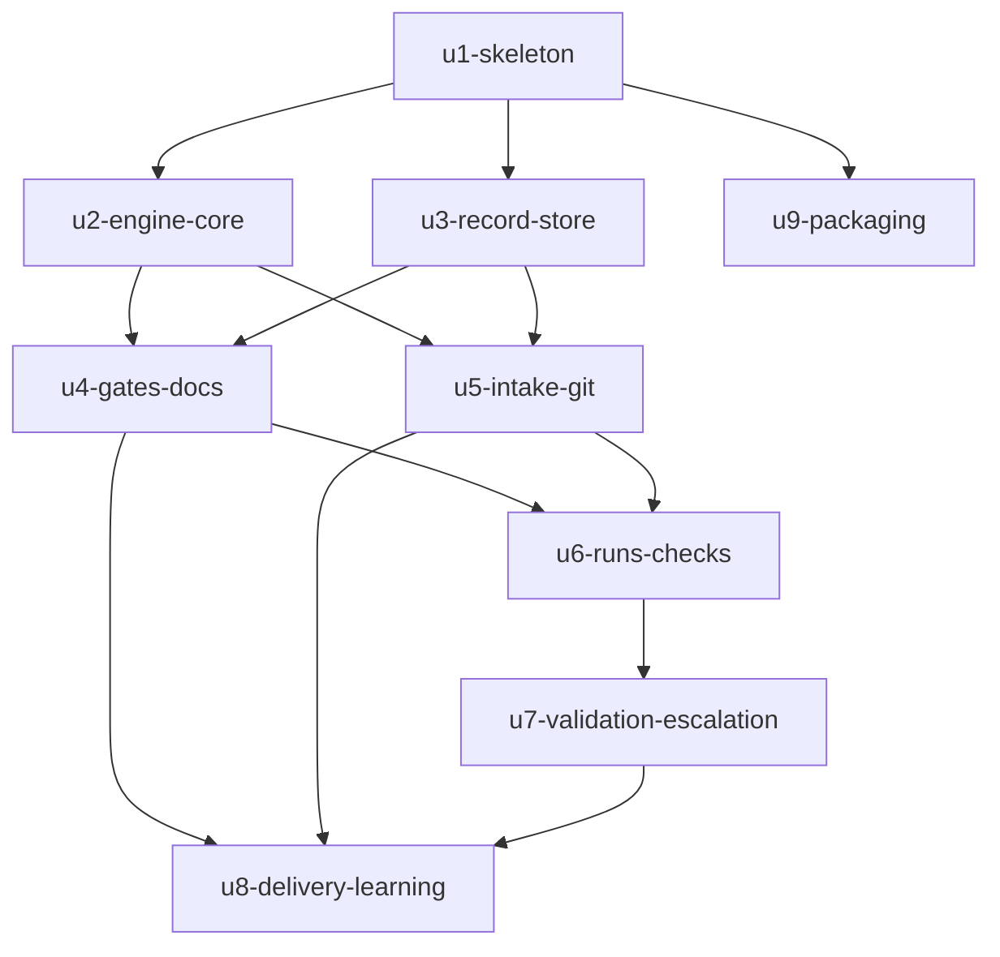

# Unit Dependencies: Agentflow MVP

## Sources

- [desc] Initial description: build Agentflow MVP from the existing PRD, addendum and architecture spine.
- [scope] Workflow-selected scope: express (custom plan `agentflow-mvp-build`).
- Unit definitions: `unit-of-work.md` in this folder; architecture spine AD-1 (dependency direction between folders).
- [Q3] Independent units are marked parallel-capable but built one at a time.

## Dependency graph

A unit depends on every unit whose code its own code or tests need.



<!-- Text fallback: u1-skeleton is the root. u2-engine-core, u3-record-store and u9-packaging depend on u1. u4-gates-docs and u5-intake-git each depend on u2 and u3. u6-runs-checks depends on u4 and u5. u7-validation-escalation depends on u6. u8-delivery-learning depends on u4, u5 and u7. -->

```yaml
units:
  - name: u1-skeleton
    kind: service
    depends_on: []
  - name: u2-engine-core
    kind: library
    depends_on: [u1-skeleton]
  - name: u3-record-store
    kind: library
    depends_on: [u1-skeleton]
  - name: u4-gates-docs
    kind: service
    depends_on: [u2-engine-core, u3-record-store]
  - name: u5-intake-git
    kind: service
    depends_on: [u2-engine-core, u3-record-store]
  - name: u6-runs-checks
    kind: service
    depends_on: [u4-gates-docs, u5-intake-git]
  - name: u7-validation-escalation
    kind: service
    depends_on: [u6-runs-checks]
  - name: u8-delivery-learning
    kind: service
    depends_on: [u4-gates-docs, u5-intake-git, u7-validation-escalation]
  - name: u9-packaging
    kind: packaging
    depends_on: [u1-skeleton]
```

## Integration points

| Between | Shared contract |
| --- | --- |
| u1 and every later unit | The skeleton's public shapes: record file, `state_get` reply kinds, tool envelope |
| u2 and u3 consumers | Zod schemas and TypeScript types in `engine/schemas` (State, Gate Record, Run Report, effects) |
| u4 and u6 | Gate Record and Approved Version; the Current Plan function |
| u5 and u6 | Snapshots and the Run diff used by `commit_prepare` and attribution |
| u6 and u7 | Run Report `result` schemas, Review Bundle recipes |
| u7 and u8 | Verdict and validated HEAD, consumed by the push Gate |
| u9 and u6 | `personas.yml` read by both the generator and the runtime check |

## Parallel development opportunities

Units with no edge between them may be built at the same time; you will build one at a time.

- u2-engine-core, u3-record-store and u9-packaging, once u1 is done.
- u4-gates-docs and u5-intake-git, once u2 and u3 are done.
